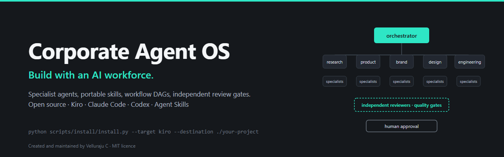
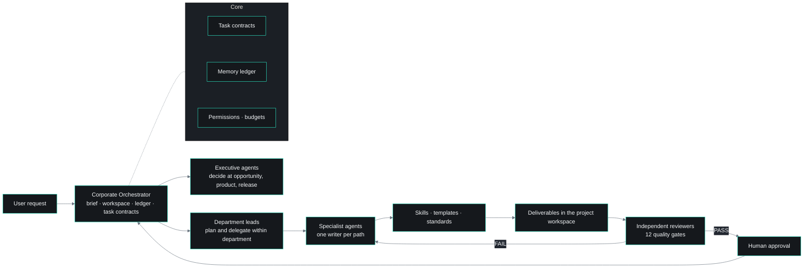
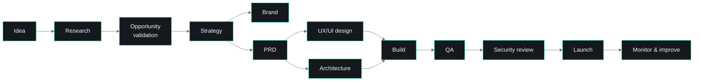
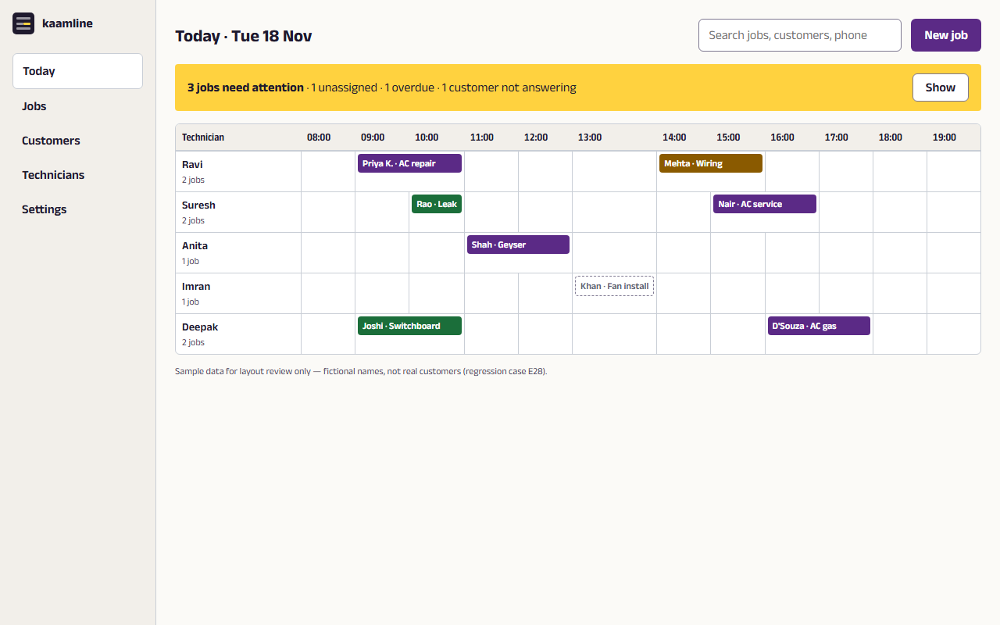
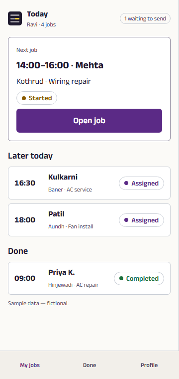

<p align="center">
  
</p>

# Corporate Agent OS

### Build with an AI workforce.

An open-source operating system for coordinating specialist AI agents, reusable skills and multi-platform workflows, so an idea can be researched, validated, branded, designed, engineered, tested and launched with the discipline of a professional organisation rather than the output of one general-purpose assistant.

[](LICENSE)
[](CHANGELOG.md)
[](docs/known-limitations.md)
[](docs/installation/INSTALLATION.md)
[](https://agentskills.io/specification)
[](powers/kiro/corporate-agent-os/)

[](https://github.com/Ryha-Technologies/corporate-agent-os/actions/workflows/validate.yml)
[](https://github.com/Ryha-Technologies/corporate-agent-os/stargazers)
[](https://github.com/Ryha-Technologies/corporate-agent-os/issues)

**Quick links:** [Install](docs/installation/INSTALLATION.md) · [Getting started](docs/getting-started/README.md) · [Concepts](docs/architecture/concepts.md) · [Compatibility](docs/platform-compatibility-matrix.md) · [Worked run](examples/worked-runs/field-service-design/) · [Known limitations](docs/known-limitations.md) · [Contributing](CONTRIBUTING.md)

---

## Why this exists

Most AI workflows hand one assistant every job: research the market, write the PRD, pick a brand colour, design the screens, write the code, review the code, declare it done. Nothing checks it. Nothing records where a "fact" came from. Nothing stops it approving its own work.

A real organisation does not work that way. It has roles with defined responsibilities, hand-offs with explicit inputs and outputs, independent review, and a person who signs off before money is spent or something ships.

Corporate Agent OS applies that model to AI agents:

| Instead of… | Corporate Agent OS has… |
|---|---|
| One prompt doing everything | 58 agents in five tiers: orchestrator, executives, department leads, specialists, independent reviewers |
| Advice in chat | A project workspace on disk and a memory ledger where facts, hypotheses, assumptions and decisions carry provenance |
| "Looks done" | 12 quality gates, each judged by a reviewer that did not create the work |
| Ad-hoc hand-offs | Task contracts with objective, inputs, outputs, file ownership, budget, acceptance criteria and verification |
| Self-declared "production-ready" | Human approval required for production, publishing, spend, legal filings, personal data, deletion and access changes |
| Prompts tied to one tool | Portable Agent Skills plus adapters for Kiro (Power, agents, steering, hooks), Claude Code and Codex |

It is **not** a company, a guarantee, or legal/financial/security clearance. Skills guide a model; the host runtime supplies tools and permissions; humans stay accountable.

## What it can do

| Department | Skills | Produces |
|---|---|---|
| **Business intelligence** | research-intelligence, competitive-analysis, business-idea-validation | Evidence ledger, competitor map, opportunity assessment with kill criteria |
| **Strategy and product** | strategy-market-sizing, business-model-unit-economics, product-discovery-prd | Strategy memo, ranged unit economics, PRD with testable acceptance criteria |
| **Branding** | brand-strategy-story, naming-ip-screen, logo-design, brandbook-identity, creative-production | Category audit, brand strategy, naming report with preliminary IP statuses, identity, brandbook |
| **Product design** | ux-research, information-architecture, ui-ux-design, design-system, accessibility-audit | Flows, IA, states matrix, tokens with computed contrast, WCAG 2.2 AA review |
| **Engineering** | architecture-system-design, api-database-design, software-engineering, code-review, devops-sre, data-ai-systems | ADRs, contracts, reviewed increments, release checklist |
| **Security and quality** | threat-modeling, security-privacy, incident-response, test-strategy, qa-evaluation, anti-slop-quality-gate, originality-audit | Threat model, findings with retests, traceability matrix, GO / NO_GO |
| **Growth and operations** | growth-gtm, product-launch, sales-partnerships, customer-success-support, finance-operations, people-operations, technical-documentation | Launch plan, playbooks, budgets, role charters, verified docs |
| **Legal research** | legal-risk-governance, oss-reuse-license | Issue register, component register, counsel questions (never legal advice) |
| **Coordination** | corporate-orchestrator | Brief, workspace, task contracts, gate verdicts, ten-part report |

39 skills · 58 agents · 22 departments / 110 roles · 9 workflows · 12 gates · 58 templates · 11 standards. Full lists: [agents directory](docs/agents/README.md), [organisation directory](docs/organization/README.md).

## How it works



1. **Intake** — the orchestrator writes `00-intake/brief.md`, creates the project workspace (`00-intake` … `10-decisions`) and a ledger where every statement is typed (fact, hypothesis, assumption, decision…) with provenance.
2. **Plan** — a workflow DAG is instantiated into task contracts with budgets by risk.
3. **Delegate** — specialists run as real sub-agents on Kiro and Claude Code (sequential passes on Codex), each writing only inside its ownership.
4. **Review** — every gated stage is judged by a read-only reviewer against `core/quality-gates/gates.yaml`. Creators never approve their own work.
5. **Approve** — policy-defined actions pause for a named human; approvals are recorded.
6. **Report** — what exists, how it was verified, and what was `NOT_RUN`.

Details: [architecture overview](docs/architecture/overview.md) · [orchestration guide](docs/governance/orchestration-guide.md).

## The organisation

| Tier | Count | Writes? | Role |
|---|---|---|---|
| Orchestrator | 1 | brief, decisions | Plans, delegates, integrates, enforces gates, asks for approval |
| Executives (CEO, COO, CTO, CPO, CFO, CMO, CISO, CLO) | 8 | no | Decide trade-offs; advise only |
| Department leads | 10 | own folder | Coordinate specialists; may delegate inside their department |
| Specialists | 28 | own paths | Do the work with the department's skills |
| Independent reviewers | 11 | no | Judge gates; return PASS / PASS_WITH_ACCEPTED_RISK / FAIL / NOT_ASSESSED |

The model is configurable. A one-page copy change engages one specialist and one reviewer, not a company; `core/budget-management/budget-policy.yaml` caps parallelism and active specialists. Startup-stage guidance in every department says who holds which roles when the team is two to five people.

## End-to-end lifecycle



Nine workflow DAGs cover this spine and its parts: `idea-to-business`, `business-validation`, `brand-development`, `product-discovery`, `product-design`, `software-development`, `security-review`, `product-launch`, `product-maintenance`. Each stage names its agent, skills, outputs, dependencies, gate, reviewer and whether a human must approve; a validator rejects cycles, self-review and overlapping writers. See [workflows](docs/workflows/README.md).

## Platform compatibility

Verified against official documentation on 2026-11-18. "Live" means an agent session on that host loaded the files; see the matrix for what has and has not been run.

| Platform | Skills | Agents / sub-agents | Always-on instructions | Hooks | Packaging | Status |
|---|---|---|---|---|---|---|
| Kiro IDE 1.x | `.kiro/skills/` | `.kiro/agents/*.json` with `permissions.rules` and `subagent/<id>` allow-lists | `.kiro/steering/` | `.kiro/hooks/*.json` v1 | Kiro Power (Agent Plugins 1.0.0) | Implemented; format-validated; IDE live run pending |
| Kiro CLI v3 | same | same | same | same (global hooks too) | same | **Live-verified on CLI 3.3.0**: all 58 agents pass `kiro-cli agent validate` and appear in `kiro-cli agent list` |
| Claude Code | `.claude/skills/` | `.claude/agents/*.md` (tools, preloaded skills, `model: inherit`) | `CLAUDE.md` | not shipped (documented) | plugin not shipped | Implemented; format-validated; live run pending |
| Codex CLI / IDE | `.agents/skills/` | none (roles in `AGENTS.md`; sequential passes) | `AGENTS.md` | n/a | plugin not shipped | Implemented with limits; live run pending |
| Other Agent Skills clients | copy `skills/<name>/` | n/a | n/a | n/a | Power folder loads in Agent Plugins clients | Portable by spec; untested |

Full matrix with per-capability status: [docs/platform-compatibility-matrix.md](docs/platform-compatibility-matrix.md). Platform guides: [Kiro](docs/platform-guides/kiro.md) · [Claude Code](docs/platform-guides/claude-code.md) · [Codex](docs/platform-guides/codex.md).

## Quick start

**Requirements:** Python 3.10+; PyYAML for the validators (`pip install pyyaml`); one of Kiro IDE/CLI, Claude Code or Codex. No API keys are stored by this project; your host supplies the model.

```bash
git clone https://github.com/ryha-technologies/corporate-agent-os.git
cd corporate-agent-os
python scripts/validate/run_all.py           # expect: 10/10 validators passed

# Preview, then install into YOUR project (never into this repository)
python scripts/install/install.py --target kiro   --destination /path/to/project --dry-run
python scripts/install/install.py --target kiro   --destination /path/to/project
# or: --target claude | --target codex | --target all
```

Then, in your host:

| Host | Start |
|---|---|
| Kiro | Trust the workspace, pick the `corporate-orchestrator` agent (or import `powers/kiro/corporate-agent-os` as a Power) |
| Claude Code | `/corporate-orchestrator` |
| Codex | `$corporate-orchestrator` |

First request to try:

> Use the corporate orchestrator. Run the business-validation workflow for this idea: a scheduling tool for small field-service businesses in India that coordinate technicians over WhatsApp. Ask me one blocking question if you need to; otherwise state assumptions and proceed.

Expected on disk: `00-intake/brief.md`, `10-decisions/memory-ledger.jsonl`, `10-decisions/tasks/*.json`, research and assessment files, gate verdicts in `07-quality/`, and a final report whose last section lists what was not run. The installer shows its plan first, backs up anything it replaces, writes a manifest and can `--uninstall`. Problems: [troubleshooting](docs/troubleshooting/README.md).

## A worked run (real artefacts, honestly labelled)

`examples/worked-runs/field-service-design/` is the `product-design` and `brand-development` workflows executed end to end by one model acting as each role in turn, for the field-service idea above. It contains the validated ledger and task contracts, IA, flows, a 14-screen states matrix, a competitor pattern map built from seven live homepage captures (dated), a brand strategy with three compared directions, a naming report in which two candidates were dropped as `POTENTIAL_CONFLICT`, hand-drawn SVG marks, a brandbook, tokens with contrast computed by script, HTML prototypes built from those tokens, and headless-Chrome screenshots.

<p align="center">
  
  
</p>

The gate verdict for that run is **FAIL**, and that is the point: the design-QA pass found and fixed three rendering defects, the originality scorecard passes, but the gate refuses to pass without a PRD, customer research and a screened name. Nothing in the example is a benchmark result or a cleared brand; see its [README](examples/worked-runs/field-service-design/README.md).

## Repository layout

| Directory | Purpose | Type |
|---|---|---|
| [`core/`](core/) | Orchestrator procedure, task-contract / workflow / memory schemas, permissions, model routing, budgets, 12 quality gates | Specification + validators |
| [`departments/`](departments/) | 22 departments, 110 roles with 15 fields each | Specification |
| [`agents/`](agents/) | 58 canonical agent definitions (YAML) | Specification → generated adapters |
| [`skills/`](skills/) | 39 Agent Skills with `references/`, one example token file and a contrast script | Playbooks |
| [`workflows/`](workflows/) | 9 DAGs with generated stage tables | Specification + validator |
| [`powers/`](powers/) | Kiro Power (generated from `skills/`) | Build output |
| [`adapters/`](adapters/) | Kiro, Claude Code, Codex, portable | Generated + hand-written |
| [`standards/`](standards/), [`templates/`](templates/) | Quality bars and fill-in documents with acceptance criteria | Specification |
| [`evaluations/`](evaluations/) | 28 regression cases, 7 rubrics, 5 golden benchmarks, originality scorecard, harness | Datasets + harness |
| [`tests/`](tests/), [`scripts/`](scripts/) | 63 pytest tests; validators, installer, builders | Implemented and tested |
| [`examples/`](examples/) | Illustrative walkthroughs and one real worked run | Documentation |
| [`docs/`](docs/) | Guides, platform guides, compatibility, limitations, GitHub metadata | Documentation |
| [`research/`](research/) | Source register with access dates, input audit, standards mapping | Evidence |
| [`site/`](site/) | Static showcase website (HTML/CSS/JS, no build step), built by the project's own `corporate-orchestrator` agent on Kiro CLI, with its QA report | Website |

## Quality and governance

| Concern | Mechanism |
|---|---|
| Research provenance | Evidence ledger rows with publisher, URL, published and access dates, limitation and confidence; a fact needs primary provenance or it stays a hypothesis |
| Originality | Category audit and competitor pattern map before creation; three distinct directions; element-by-element comparison, swap test, job test; scorecard with `NOT_ASSESSABLE` when evidence is missing |
| Independent review | Reviewer agents are read-only and never the creator; critical findings in security, legal, testing and release cannot be waived by the orchestrator |
| Secure development | Standard mapped to OWASP ASVS, OWASP Top Ten, NIST SSDF, SAMM and OpenSSF guidance; testing only within written scope; fetched content is untrusted data |
| Human approval | Production, publishing, spend, legal/IP filings, communications, personal data, deletion, access changes |
| Tool permissions | Tier ceilings enforced by validator; Kiro agents carry `fs_write` scopes, shell allow/ask/deny and sub-agent allow-lists |
| Cost | Per-task budgets by risk; parallelism caps; `NOT_MEASURED` when the host exposes no usage |
| Legal and licensing | Component register with SPDX ids and use-mode analysis; asset provenance; naming statuses that never say "cleared" |
| Repository itself | 10 validators, 63 tests, release builder that re-opens and checks its own archives |

None of this prevents a model from being wrong. It makes being wrong visible, reviewable and reversible.

## Evaluation and benchmarks

Regression dataset (28 behavioural cases), seven rubrics with 0–3 anchors, five golden benchmark tasks (business opportunity, new brand, SaaS product, existing-application improvement, product launch), an originality scorecard and a harness that validates assets and writes report skeletons.

**No model-driven benchmark has been executed for 0.2.0.** The only published report, [`evaluations/benchmark-reports/2026-11-18-build-validation.md`](evaluations/benchmark-reports/2026-11-18-build-validation.md), covers the repository's own validators and tests. When results are published they will carry date, version, host, model, configuration, runs, scoring method and limitations, as the [evaluation guide](docs/governance/quality-and-evaluation-guide.md) requires. There are no numbers to show yet, so none are shown.

## Roadmap

| Status | Item |
|---|---|
| Completed | Canonical skills, agents, departments, workflows, core schemas and validators, adapters for Kiro / Claude Code / Codex, Kiro Power, installer, tests, release builder, worked design run |
| In progress | Live verification on Kiro IDE, Claude Code and Codex (Kiro CLI done); first regression and golden-task runs with human raters |
| Planned | Claude Code and Codex plugin packaging; product-UI competitor captures for the worked run; more `references/` depth per skill |
| Under investigation | Portable hook equivalents outside Kiro; cost telemetry per host; a thin MCP server exposing skills to MCP-only clients |
| 1.0 criteria | Benchmarks A–E run on at least two hosts with published reports; live installs verified on all three hosts; no open high findings in `docs/known-limitations.md` |

## Contributing

Read [CONTRIBUTING.md](CONTRIBUTING.md). Short version: edit canonical sources, regenerate adapters and the Power, run `python scripts/validate/run_all.py` and `python -m pytest -q`, add a regression case for any failure mode you address. Guides: [create a skill](docs/governance/skill-development-guide.md) · [create an agent](docs/development/create-an-agent.md) · [create a workflow](docs/development/create-a-workflow.md) · [add a platform adapter](docs/development/create-an-adapter.md). Issue templates exist for bugs, features, skill, agent and adapter proposals, and documentation.

## Community and support

- Bugs and feature requests: GitHub Issues (templates in `.github/ISSUE_TEMPLATE/`)
- Security reports: [SECURITY.md](SECURITY.md) — private reporting, never a public issue
- Documentation: [docs/README.md](docs/README.md)
- Website: [ryha-technologies.github.io/corporate-agent-os](https://ryha-technologies.github.io/corporate-agent-os/) (source in [`site/`](site/), deployed by `.github/workflows/pages.yml`)
- Releases: [CHANGELOG.md](CHANGELOG.md) and the release process in [docs/governance/release-process.md](docs/governance/release-process.md)
- Discussions: enable in repository settings after publishing (see [docs/github/repository-metadata.md](docs/github/repository-metadata.md))

## Author

Created and maintained by **Velluraju C** — [GitHub](https://github.com/velluraju) · [LinkedIn](https://www.linkedin.com/in/velluraju). Hosted under the Ryha-Technologies GitHub organisation. Licensed under MIT.

Explore the skills, install it into a project, run a workflow, and open an issue when it falls short of the standard it sets for itself.
